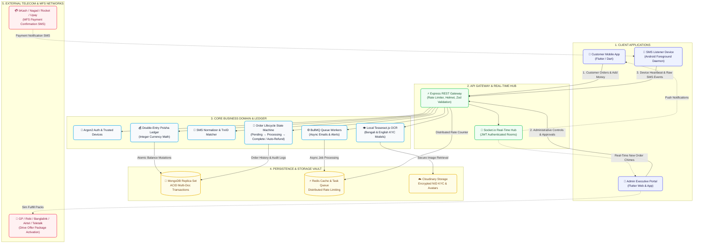

# 🚀 Alokito Telecom (Drive Offer) — Core Backend Engine

[](https://nodejs.org/)
[](https://www.typescriptlang.org/)
[](https://expressjs.com/)
[](https://mongoosejs.com/)
[](https://redis.io/)
[](https://socket.io/)
[]()

The central REST API and WebSocket orchestration engine powering the **Alokito Telecom** ecosystem. Designed specifically for the high-volume telecom drive offer, mobile recharge, and instant automated wallet top-up industry in Bangladesh.

It coordinates between the **Customer Mobile App**, **Executive Admin App**, and dedicated **Android SMS Listener Devices** to deliver an automated, end-to-end telecom pack fulfillment and fintech ledger experience.

---

## 🌐 Ecosystem Architecture

The backend sits at the center of a 4-component distributed ecosystem:



---

## 🛠️ Technology Stack

| Layer | Technologies |
| :--- | :--- |
| **Runtime & Language** | **Node.js** (v18+) with **TypeScript 5.5** (strict mode) |
| **HTTP Framework** | **Express 4.19** with async error handling wrappers |
| **Database & ODM** | **MongoDB 7+** via **Mongoose 8** (Requires Replica Set for ACID Multi-Document Transactions) |
| **Cache & Task Queue** | **Redis** via `ioredis` + **BullMQ 5** for asynchronous resilient job dispatch |
| **Real-time Gateway** | **Socket.io 4.8** with JWT-authenticated channel rooms (`socket.join(userId)`) |
| **Computer Vision (KYC)** | **Tesseract.js 7.0** running local OCR (Bengali & English trained models) |
| **Cloud Storage** | **Cloudinary** for private signed NID document uploads and public profile avatars |
| **Security & Cryptography** | **Argon2** for password/PIN hashing, **Helmet** for HTTP headers, distributed rate limiting via `rate-limit-redis` |
| **Validation & Docs** | **Zod 3.23** schema validation with **Swagger UI** (`@asteasolutions/zod-to-openapi`) |

---

## 🧠 Core Engineering Principles

### 1. Integer-Based "Poisha" Double-Entry Ledger
* All monetary balances and calculations are strictly stored in integer **poisha** (1 BDT = 100 poisha).
* Floating-point calculations are strictly forbidden to eliminate rounding errors.
* Every balance mutation (deposit, purchase, commission, refund) writes an immutable record to the `WalletTransaction` collection within a MongoDB ACID multi-document transaction session.

### 2. Automated SMS Verification & Normalizer Pipeline
* Physical Android phones running the **Driver SMS Listener App** receive real-time SMS from bKash (`bKash`), Nagad (`Nagad`), Rocket (`16216`), and Upay.
* Raw SMS bodies are sent to the `/payment-devices/sms-events` endpoint with device authorization.
* The backend normalizer regex parser extracts the Transaction ID (`TrxID`), sender number, and amount.
* When a customer requests an Add Money top-up and inputs their TrxID, the system automatically matches the claim against captured SMS logs, crediting the customer's wallet instantly without manual admin intervention.

### 3. Edge-Preserving Local NID OCR Extraction
* During user registration, front and back NID images are pre-processed and passed to local `Tesseract.js` using local trained datasets (`ben.traineddata`, `eng.traineddata`).
* Extracts national identity number, date of birth, and customer name without sending sensitive personal data to external unverified third-party APIs.

### 4. Resilient Order Lifecycle State Machine
Orders transition predictably across distinct states:

`PENDING` → `PROCESSING` → `COMPLETED` (or `FAILED` / `CANCELLED`)

* If an order fails or is cancelled by an administrator, the backend **automatically triggers an instant atomic refund** back into the customer's wallet ledger.

---

## 📁 Repository Structure

```
alokito-telecom-backend/
├── src/
│   ├── config/              # Environment, DB, Redis, and Socket.io setup
│   ├── docs/                # OpenAPI/Swagger compilation registry
│   ├── integrations/        # Cloudinary, Nodemailer, Tesseract NID helper
│   ├── jobs/                # BullMQ queues, workers, and scheduled jobs
│   ├── middleware/          # Auth, Upload (Multer), RateLimiter, Validator
│   ├── modules/             # Domain Driven Business Feature Modules
│   │   ├── admins/          # Admin account management and statistics
│   │   ├── auditLogs/       # Immutable security audit trails
│   │   ├── auth/            # Customer JWT, OTPs, Device verification
│   │   ├── driveOffers/     # Discounted drive packs configurations
│   │   ├── notifications/   # In-app user notifications & alerts
│   │   ├── offers/          # General operator recharge packs
│   │   ├── operators/       # GP, Robi, Banglalink, Airtel, Teletalk
│   │   ├── orders/          # Core order lifecycle & state transitions
│   │   ├── paymentDevices/  # SMS Listener pairing, heartbeats, logs
│   │   ├── refunds/         # Automatic & manual refund controllers
│   │   ├── topups/          # Wallet topups and automatic SMS claim match
│   │   ├── users/           # Customer accounts, NID KYC, trusted devices
│   │   ├── walletTransactions/# Double-entry ledger logs
│   │   └── wallets/         # Ledger balances (stored in integer poisha)
│   ├── routes/              # Central v1 route index
│   ├── sms/                 # SMS normalizer parser (bKash, Nagad, Rocket)
│   ├── shared/              # API Envelopes, AppErrors, Enums, Utilities
│   ├── app.ts               # Express configuration & middleware pipeline
│   └── server.ts            # Entrypoint, Socket.io initialization & cleanup
├── scripts/                 # Maintenance, E2E test scripts, production clean
├── ben.traineddata          # Tesseract Bengali language model
├── eng.traineddata          # Tesseract English language model
├── package.json             # NPM dependencies and scripts
└── tsconfig.json            # TypeScript configuration
```

---

## ⚙️ Environment Variables

Create a `.env` file in the root directory:

```env
# Server
NODE_ENV=development
PORT=4000

# Database & Cache (Replica Set Required for MongoDB Transactions)
MONGODB_URI=mongodb://localhost:27017/alokito_telecom?replicaSet=rs0
REDIS_URL=redis://localhost:6379

# Authentication & Security
JWT_ACCESS_SECRET=your_super_secret_access_jwt_key_at_least_32_chars
JWT_ACCESS_EXPIRES=15m
JWT_REFRESH_SECRET=your_super_secret_refresh_jwt_key_at_least_32_chars
JWT_REFRESH_EXPIRES=30d

# Mailer (Nodemailer SMTP)
SMTP_HOST=smtp.gmail.com
SMTP_PORT=587
SMTP_SECURE=false
SMTP_USER=your_email@gmail.com
SMTP_PASS=your_app_password
EMAIL_FROM=Alokito Telecom <no-reply@alokitotelecom.com>

# Cloudinary (Media & KYC storage)
STORAGE_PROVIDER=cloudinary
CLOUDINARY_CLOUD_NAME=your_cloudinary_name
CLOUDINARY_API_KEY=your_cloudinary_key
CLOUDINARY_API_SECRET=your_cloudinary_secret

# OTP & Heartbeat Thresholds
OTP_EXPIRY_SECONDS=300
OTP_MAX_ATTEMPTS=5
OTP_RESEND_COOLDOWN=60
DEVICE_HEARTBEAT_TIMEOUT_SECONDS=120

# Rate Limiting
RATE_LIMIT_WINDOW_MS=60000
RATE_LIMIT_MAX=120
```

---

## 📡 API Reference Catalog

All REST endpoints are prefixed with `/api/v1`. Live interactive documentation is available at:
* **Interactive Swagger UI**: `http://localhost:4000/api/docs`
* **OpenAPI 3.0 JSON Spec**: `http://localhost:4000/api/docs/openapi.json`

### Key Route Summary

| Module | Method & Path | Access | Description |
| :--- | :--- | :--- | :--- |
| **Auth** | `POST /auth/register` | Public | Customer signup with NID front/back images (triggers Tesseract OCR) |
| **Auth** | `POST /auth/register/verify` | Public | Verify OTP and create customer wallet |
| **Auth** | `POST /auth/login` | Public | Customer PIN authentication with trusted device check |
| **Auth** | `POST /auth/login/verify-device` | Public | Verify OTP when logging in from a new/unrecognized device |
| **Auth** | `POST /auth/refresh` | Public | Refresh expired access token |
| **Auth** | `POST /auth/forgot-pin` | Public | Request PIN reset OTP |
| **Auth** | `POST /auth/reset-pin` | Public | Reset PIN with verified token |
| **Users** | `GET /users/me` | Customer | Fetch current customer profile & KYC status |
| **Users** | `POST /users/me/change-pin` | Customer | Change existing PIN |
| **Offers** | `GET /operators` | Customer | List active telecom operators (GP, Robi, BL, Airtel, Teletalk) |
| **Offers** | `GET /drive-offers` | Customer | List active discounted drive packages |
| **Wallet** | `GET /wallet` | Customer | Get customer balance in poisha & BDT |
| **Wallet** | `POST /wallet/topups` | Customer | Create Add Money top-up intent |
| **Wallet** | `POST /wallet/topups/:id/verify` | Customer | Submit TrxID for automatic SMS matching |
| **Orders** | `POST /orders` | Customer | Place purchase order with PIN confirmation |
| **Orders** | `GET /orders` | Customer | View customer order history & live status |
| **Devices** | `POST /payment-devices/pair` | Public (Code) | Pair SMS Listener device via 6-digit code |
| **Devices** | `POST /payment-devices/heartbeat` | Device | Periodic keep-alive ping |
| **Devices** | `POST /payment-devices/sms-events` | Device | Ingest raw SMS payload from bKash/Nagad/Rocket |
| **Admin** | `POST /admin/auth/login` | Public | Admin email + password login |
| **Admin** | `GET /admin/dashboard` | Admin | Aggregate metrics, pending orders, and online devices |
| **Admin** | `GET /admin/orders` | Admin | Filter system orders by status, operator, and date |
| **Admin** | `POST /admin/orders/:id/process` | Admin | Claim and process pending order |
| **Admin** | `POST /admin/orders/:id/complete` | Admin | Mark order completed (notifies customer) |
| **Admin** | `POST /admin/orders/:id/fail` | Admin | Mark order failed (triggers **auto wallet refund**) |
| **Admin** | `POST /admin/payment-devices/pair` | Admin | Generate 6-digit device pairing code |
| **Admin** | `GET /admin/users` | Admin | Search users, inspect NID docs, block/unblock |

---

## 🔔 Real-Time WebSocket Channels

Clients connect via **Socket.io** (`ws://localhost:4000`) with JWT authorization:

```javascript
import { io } from "socket.io-client";

const socket = io("http://localhost:4000", {
  auth: { token: "CUSTOMER_OR_ADMIN_JWT_TOKEN" }
});

// Customer listens for live notification broadcasts:
socket.on("new_notification", (notification) => {
  console.log("Notification received:", notification);
});

// Admin listens for instant new order chimes:
socket.on("new_order", (order) => {
  console.log("New order placed:", order);
});
```

---

## 🚀 Setup & Local Development

### Prerequisites
* **Node.js**: v18.0.0 or higher
* **MongoDB**: v6.0+ (Must be started with a replica set to enable multi-document transactions)
  ```bash
  # Start local replica set on macOS:
  mongod --dbpath /usr/local/var/mongodb --replSet rs0
  # In another terminal:
  mongosh --eval "rs.initiate()"
  ```
* **Redis**: v6.0+
  ```bash
  redis-server
  ```

### Installation Steps

1. **Clone and install dependencies**:
   ```bash
   cd alokito-telecom-backend
   npm install
   ```

2. **Configure environment**:
   ```bash
   cp .env.example .env
   # Edit .env with your local MongoDB, Redis, and Cloudinary keys
   ```

3. **Start in development mode**:
   ```bash
   npm run dev
   ```
   Server boots on `http://localhost:4000` with hot-reload via `tsx`.

4. **Run Verification & E2E Tests**:
   ```bash
   # Run unit & integration tests:
   npm run test

   # Validate TypeScript types:
   npm run typecheck

   # Test full E2E recharge, order, and refund lifecycle:
   npx tsx scripts/test-full-e2e-flow.ts
   ```

---

## 🚢 Production Deployment

### Building the Bundle
```bash
npm run build
```
Compiles TypeScript into clean JavaScript files in the `dist/` directory.

### Running with PM2
```bash
pm2 start dist/server.js --name "alokito-backend" -i max
```

### Docker Deployment
```bash
docker build -t alokito-telecom-backend .
docker run -p 4000:4000 --env-file .env alokito-telecom-backend
```

---

## 🛡️ Security & Reliability

* **Argon2 Hashing**: Resilient to GPU cracking attacks for customer PINs and admin credentials.
* **Signed Cloudinary URLs**: Sensitive KYC NID pictures cannot be accessed publicly without time-limited signed tokens.
* **Distributed Redis Rate Limiting**: Protects sensitive endpoints (`/auth/login`, `/auth/register`, `/wallet/topups/:id/verify`) from brute-force and DDoS attacks.
* **Graceful Shutdown**: Handles `SIGTERM` and `SIGINT` signals to flush BullMQ queues, finish in-flight DB operations, and close WebSocket pools cleanly.

---

## 📄 License & Maintainer

Developed for the **Alokito Telecom** Ecosystem. All rights reserved.
For inquiries, deployment, or technical support, contact the system administrator.
